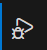
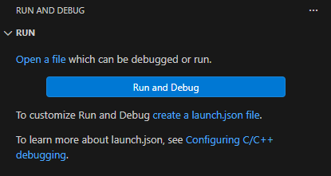
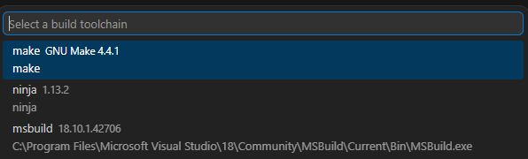

# configurations

Premake Manager automatically detects the premake5.lua file and exports the the projects,workspaces,configurations using the [export](https://github.com/lolrobbe2/premake-export) module. it consequently reads the exported JSON and generates tasks, debug configurations.

> [!WARNING] for debugging to work you will need the CPP extension. 

## launch.json

Premake manager can **automatically** create the **[launch.json](https://code.visualstudio.com/docs/debugtest/debugging-configuration)** configurations for your premake5 project.

### 1 go to the run and debug tab




### 2 pres the create launch.json button and select Premake5

you will then prompted to select your build environment:



> [!NOTE] there is no need to create a tasks.json as they are auto generated via a task provider.

```json
// example generated configuration
{
    // Use IntelliSense to learn about possible attributes.
    // Hover to view descriptions of existing attributes.
    // For more information, visit: https://go.microsoft.com/fwlink/?linkid=830387
    "version": "0.2.0",
    "configurations": [  
        {
            "name": "[test][Debug] Test (make)",
            "type": "cppdbg",
            "request": "launch",
            "program": "${workspaceFolder}/bin/Debug/Test.exe",
            "cwd": "${workspaceFolder}",
            "preLaunchTask": "Premake5: [test][Debug] Test (make)",
            "presentation": {
                "group": "test",
                "order": 0
            }
        },
        {
            "name": "[test][Release] Test (make)",
            "type": "cppdbg",
            "request": "launch",
            "program": "${workspaceFolder}/bin/Release/Test.exe",
            "cwd": "${workspaceFolder}",
            "preLaunchTask": "Premake5: [test][Release] Test (make)",
            "presentation": {
                "group": "test",
                "order": 0
            }
        }
    ]
}
```
